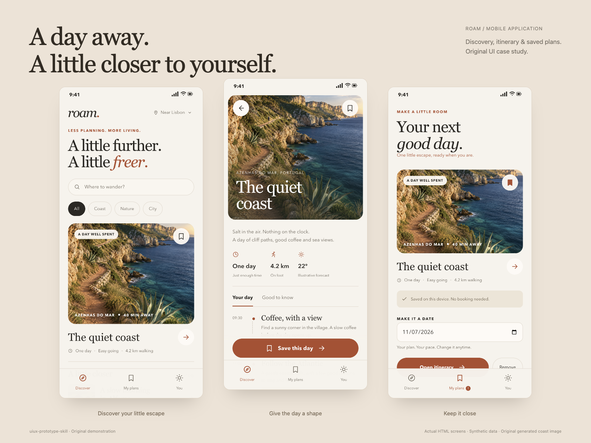
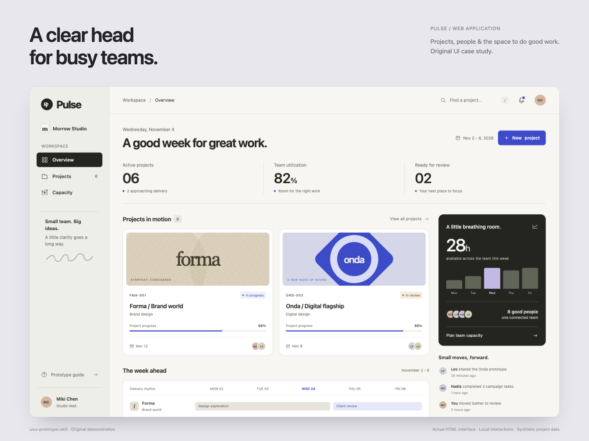
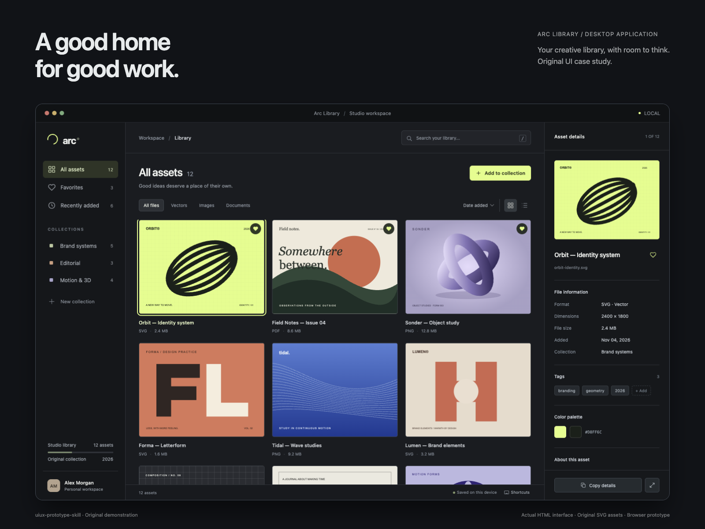
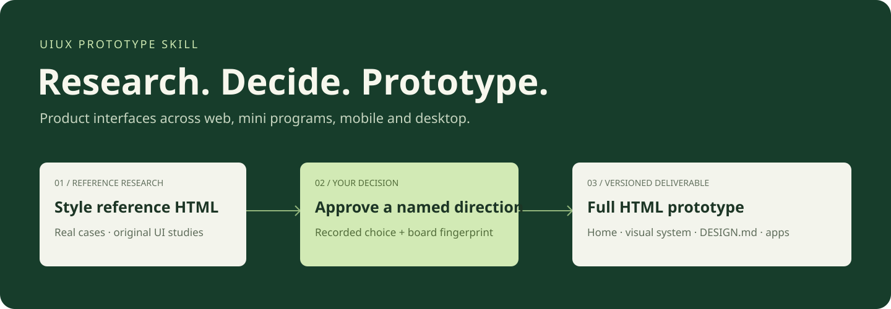
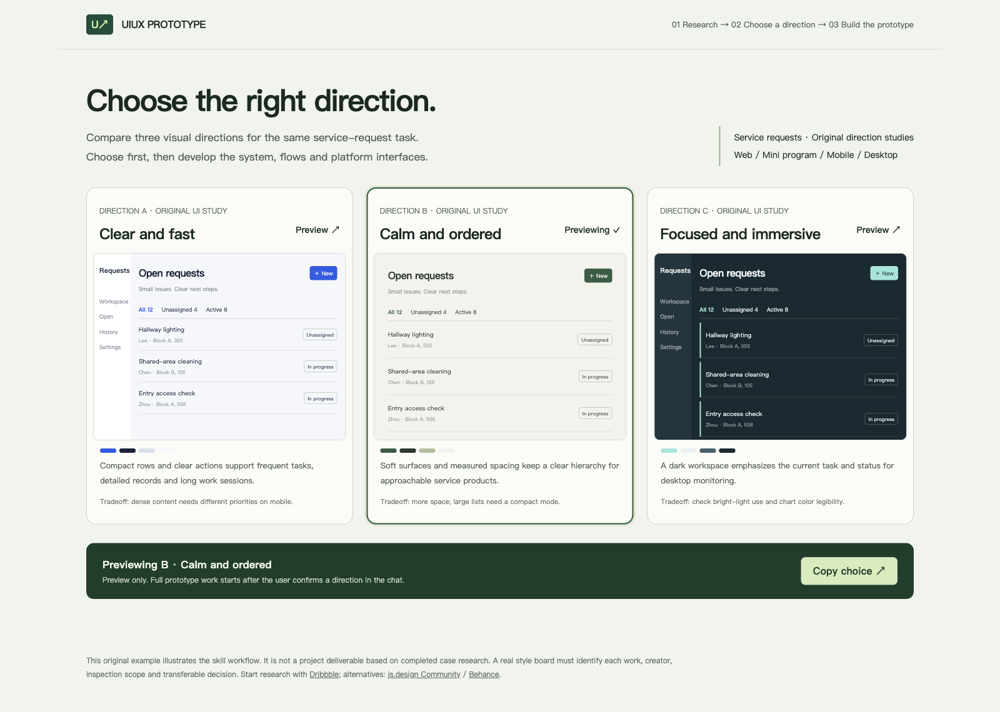
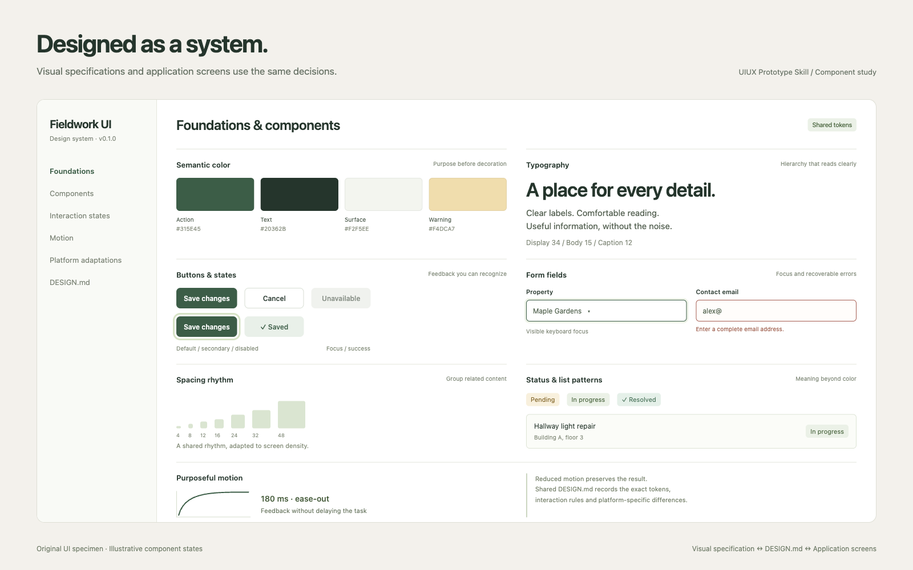

# UIUX Prototype Skill

**Research real examples, choose a direction, then build a complete product UI prototype.**

[简体中文](README.zh-CN.md)

[](https://skills.sh/stella-dust/uiux-prototype-skill)
[](https://github.com/stella-dust/uiux-prototype-skill/releases)
[](LICENSE)

A design skill for **web applications, mini programs, mobile apps and desktop apps**. It organizes interfaces around users' tasks and produces a browsable, reviewable, versioned HTML prototype before application implementation. Posters, slide decks and marketing-only landing pages are outside its main scope.

It brings together principles from [Emil Kowalski skills](https://github.com/emilkowalski/skills), [Taste Skill](https://github.com/Leonxlnx/taste-skill), [UI/UX Pro Max](https://github.com/nextlevelbuilder/ui-ux-pro-max-skill), [Anthropic frontend-design](https://github.com/anthropics/skills/tree/main/skills/frontend-design), [Impeccable](https://github.com/pbakaus/impeccable), [Hallmark](https://github.com/nutlope/hallmark) and [UXKIN](https://github.com/uxkin/agent), supplemented by [Stageshow](https://github.com/benjitaylor/skills/tree/main/stageshow), [shadcn](https://github.com/shadcn-ui/ui/tree/main/skills/shadcn) and [Web Design Reviewer](https://github.com/github/awesome-copilot/tree/main/skills/web-design-reviewer). This original synthesis covers **31 source skills** and works independently: upstream installations and paid reference services are optional. See the [contribution map and conflict decisions](skills/uiux-prototype-skill/references/source-synthesis.md) and [source and license records](THIRD_PARTY_NOTICES.md).

## Case studies

Three original, interactive HTML prototypes made with this skill. Click a preview to inspect the full-resolution image.

| Roam · Mobile | Pulse · Web | Arc Library · Desktop |
|---|---|---|
| [](docs/images/cases/01-roam-mobile.png) | [](docs/images/cases/02-pulse-web.png) | [](docs/images/cases/03-arc-desktop.png) |
| Nearby trips, itineraries and saved plans | Studio projects, capacity and collaboration | Creative assets, collections and metadata |
| [App source](examples/roam-mobile/docs/prototype/versions/v0.1.0/mobile/index.html) · [Design system](examples/roam-mobile/docs/prototype/versions/v0.1.0/design-system.html) | [App source](examples/pulse-web/docs/prototype/versions/v0.1.0/web/index.html) · [Design system](examples/pulse-web/docs/prototype/versions/v0.1.0/design-system.html) | [App source](examples/arc-desktop/docs/prototype/versions/v0.1.0/desktop/index.html) · [Design system](examples/arc-desktop/docs/prototype/versions/v0.1.0/design-system.html) |

Each case includes its style-reference HTML, source observations, shared and platform-specific DESIGN.md, a rendered UI specification, browser QA and a sealed version manifest. The UI artwork is original; the coastal hero is a generated fictional scene. These are synthetic demonstrations with local interactions.

[Browse all example sources](examples/README.md). To run the gallery, clone the repository, run `python3 -m http.server 8765 --bind 127.0.0.1` from its root, then open [localhost:8765/examples/](http://localhost:8765/examples/). GitHub's HTML links show source; the local server runs the interfaces.

## Workflow



1. **Understand the product.** Read the project's AGENTS.md, HANDOFF.md, DESIGN.md and existing interfaces. Establish users, scenarios, entry points, task paths, outcomes, screens and target platforms for this version.
2. **Research and present directions.** Start with Dribbble; use js.design Community and Behance as alternatives. Record the actual works inspected, their creators, source links, access limits and transferable decisions. Normally compare 2-3 meaningfully different directions in `style-reference.html`.
3. **Wait for the user's decision.** The user can choose a direction, request a blend or ask for revisions. A preview control inside the HTML cannot grant approval or start full prototype development.
4. **Build the complete HTML prototype.** Deliver a prototype home, rendered UI design specification, DESIGN.md and the agreed application interfaces and critical flows for every target platform in scope.
5. **Check in a browser and seal the version.** Exercise interactions, states, extreme content, responsive layouts, keyboard access and reduced motion. Record the actual verification scope and unresolved issues, while preserving earlier versions.



[Open the interactive style-reference example](docs/style-reference-example.en.html). Download the repository and open the file in a browser, or use the local server below. This original example explains the workflow; it does not represent completed real-case research or an approved project design.

## Install

Use an agent that supports Agent Skills. The marketplace CLI below requires Node.js 22.20+. The prototype version helper needs only Python 3.10+ and the standard library.

**Codex, global installation:**

```bash
npx skills@latest add stella-dust/uiux-prototype-skill \
  --skill uiux-prototype-skill -g -a codex -y
```

**Other supported agents, or interactive scope selection:**

```bash
npx skills@latest add stella-dust/uiux-prototype-skill
```

**Pin to the published release:**

```bash
npx skills@latest add \
  https://github.com/stella-dust/uiux-prototype-skill/tree/v1.0.0/skills/uiux-prototype-skill \
  -g -a codex -y
```

The CLI's Codex global directory is `~/.agents/skills/`. Some Codex environments use `~/.codex/skills/`; for manual installation, copy the entire `skills/uiux-prototype-skill/` directory into the directory your environment reads. Check for an existing skill with the same name before installing in a second location. Preserve a copy before updating customized files.

[Official CLI installation options](https://github.com/vercel-labs/skills/blob/main/docs/commands.md) · [Agent installation paths](https://github.com/vercel-labs/skills/blob/main/docs/agents.md)

## Use it in a project

For a new prototype:

```text
Use $uiux-prototype-skill to design a prototype for our resident services product.
Target a WeChat mini program and a web management app.
Read the existing product documents and DESIGN.md first, and preserve our brand blue.
Research references and deliver the style-reference HTML first.
Wait for me to choose a direction before developing the complete prototype.
```

For an existing product:

```text
Use $uiux-prototype-skill to polish our existing service-request interface.
Preserve the information architecture and brand. Improve density, states,
error recovery and cross-platform adaptation.
Show the proposed direction and its evidence before changing the full prototype.
```

After reviewing the actual style-reference HTML:

```text
I choose direction B. Preserve its layout, typography and density.
Build the complete prototype from the current style-reference version.
```

Automatic skill discovery is enabled by default; explicit invocation also works. The skill selects platforms from the project and request. It does not invent four applications for every product. Specify all four if that is the required scope.

## Deliverables

```text
project/docs/prototype/
├── index.html                         # Navigation across retained versions
├── CHANGELOG.md
└── versions/v0.1.0/
    ├── manifest.json                  # Direction, approval, state and sealed hashes
    ├── style-reference.html           # Delivered before the user chooses
    ├── references.json                # Sources and actual inspection scope
    ├── index.html                     # Prototype navigation home
    ├── design-system.html             # Rendered specification and component states
    ├── DESIGN.md                      # Design contract and exact token values
    ├── QA.md                          # Actual checks and verification limits
    ├── assets/
    ├── web/{index.html,DESIGN.md}
    ├── miniapp/{index.html,DESIGN.md}
    ├── mobile/{index.html,DESIGN.md}
    └── desktop/{index.html,DESIGN.md}
```

Only the requested platforms are generated. Each can use multiple pages or HTML-based routing and states. Its home is a working application entry point, not just a static cover. The specification covers the colors, type scale, spacing, density, layouts, icons, components, states, motion, accessibility and platform differences actually used in the version.



This design-system image is another original illustrative specimen, with editable source in [docs/ui-showcase.html](docs/ui-showcase.html). It shows how a specification can present real rendered examples alongside exact values; it is not a claim that a user project has been generated or approved.

## Prototype version helper

The helper manages workflow and files; it does not design interfaces automatically. Run these commands from the repository root. After installation, replace the script path with the absolute path inside the installed skill. `--project` must point to the application project's root.

```bash
python3 skills/uiux-prototype-skill/scripts/prototype.py init \
  --project /path/to/project --version v0.1.0 --surfaces web miniapp
```

This creates only a style-reference draft and a manifest. The agent must research real cases, replace the draft and obtain the user's direction decision. Then record the user's **actual words**:

```bash
python3 skills/uiux-prototype-skill/scripts/prototype.py record-approval \
  --project /path/to/project --version v0.1.0 \
  --direction B --evidence "The user's actual approval of direction B for this version"

python3 skills/uiux-prototype-skill/scripts/prototype.py prepare \
  --project /path/to/project --version v0.1.0
```

`prepare` creates pending design scaffolds. These are not completed prototypes. Replace them, implement the agreed flows and inspect the result in a browser before running:

```bash
python3 skills/uiux-prototype-skill/scripts/prototype.py validate \
  --project /path/to/project --version v0.1.0 --complete

python3 skills/uiux-prototype-skill/scripts/prototype.py seal \
  --project /path/to/project --version v0.1.0 \
  --summary "Record the actual browser, viewports, interaction results and unverified items"
```

Checks cover the approved style HTML's fingerprint, required files, pending scaffold markers, local HTML links, reference JSON syntax, symlinks, paths escaping the version directory and file changes after sealing. Editing the style-reference HTML invalidates its approval. Existing versions are not overwritten.

`record-approval` stores evidence provided by its caller; it does not authenticate the person giving approval. `seal` creates a change-detectable snapshot convention, not an operating-system lock or a visual sign-off.

To browse a prototype locally:

```bash
python3 -m http.server 8765 --bind 127.0.0.1 --directory /path/to/project/docs/prototype
```

Open `http://127.0.0.1:8765/versions/v0.1.0/`. The workflow illustrations can be previewed with `--directory docs`. To run the three complete product cases, serve the repository root and open `/examples/` as described above.

## What the synthesis keeps

| Source | Adopted decisions |
|---|---|
| [Emil Kowalski skills](https://github.com/emilkowalski/skills), 16 skills | Whether motion is useful; frequency, easing, duration, origin, interruption and performance; extreme content; native feel; mature component selection |
| [Taste Skill](https://github.com/Leonxlnx/taste-skill) | Infer direction from the brief, respect the brand, use credible material and inspect the browser result |
| [UI/UX Pro Max](https://github.com/nextlevelbuilder/ui-ux-pro-max-skill) | Product context, semantic tokens, type, color, layout, cross-platform specifications and UX anti-patterns |
| [Anthropic frontend-design](https://github.com/anthropics/skills/tree/main/skills/frontend-design) | Intentional visual choices and coherent implementation instead of templated defaults |
| [Impeccable](https://github.com/pbakaus/impeccable) | Prioritized audits, less redundant UI, accessibility, states, responsiveness and evidence-based fixes |
| [Hallmark](https://github.com/nutlope/hallmark) | Traceable cases and assets, primary-task clarity, retained functionality and tiered quality checks |
| [UXKIN](https://github.com/uxkin/agent), 7 skills | Real product research, state coverage, design contracts, screenshot comparison and platform workflows |
| [Stageshow](https://github.com/benjitaylor/skills/tree/main/stageshow) / [shadcn](https://github.com/shadcn-ui/ui/tree/main/skills/shadcn) / [Web Design Reviewer](https://github.com/github/awesome-copilot/tree/main/skills/web-design-reviewer) | Reviewable product scenarios, reuse of existing components and feedback from actual browser rendering |

Marketing-page section quotas, blanket color or font bans, randomly selected themes and unconditional dependency installation do not become product UI rules. The established brand, real tasks and platform constraints take priority. Motion supports interaction without delaying frequent tasks. The [source synthesis](skills/uiux-prototype-skill/references/source-synthesis.md) records each contribution, conflict decision and source revision limit.

## Verification and boundaries

```bash
python3 -m unittest discover -s tests -v
```

Tests cover approval gating and fingerprint invalidation, previous-version preservation, platform files, local links, path and symlink boundaries, QA and research records, unfinished scaffolds and post-seal changes. Workflow checks cannot replace visual judgment. HTML, browser simulation and local state do not prove mini program host behavior, native SDK support, payments, message sending, backend writes, production deployment or business outcomes.

Dribbble, js.design Community and Behance may restrict access or require login. The skill records actual access results and uses available alternatives. Being able to view a third-party screenshot does not grant redistribution rights. A UXKIN account or plan can supplement research but is not a base dependency.

## Releases and skills.sh

Source and versioned releases are published on [GitHub](https://github.com/stella-dust/uiux-prototype-skill). The [skills.sh FAQ](https://skills.sh/docs/faq) describes automatic discovery through normal installation telemetry rather than a separate manual package submission. A public repository does not prove immediate leaderboard visibility; indexing is controlled by the platform. This project does not manufacture installation counts through repeated installs.

See [CHANGELOG.md](CHANGELOG.md) and the [release history](https://github.com/stella-dust/uiux-prototype-skill/releases). Useful contributions include a concrete scenario, reproduction steps, prototype scope and browser evidence, so changes follow observed needs rather than turning one preference into a universal rule.

## License

The original instructions, version helper and demonstration materials use the [MIT license](LICENSE). Upstream projects retain their own licenses; their scripts, components, theme libraries and reference images are not copied into this repository. See [THIRD_PARTY_NOTICES.md](THIRD_PARTY_NOTICES.md).
