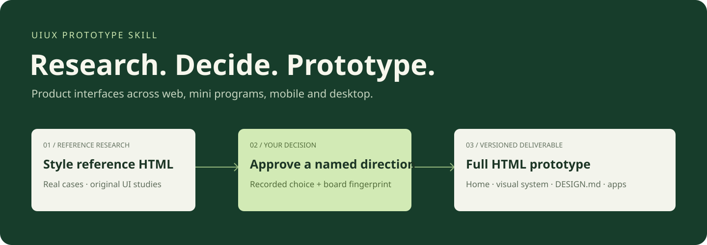
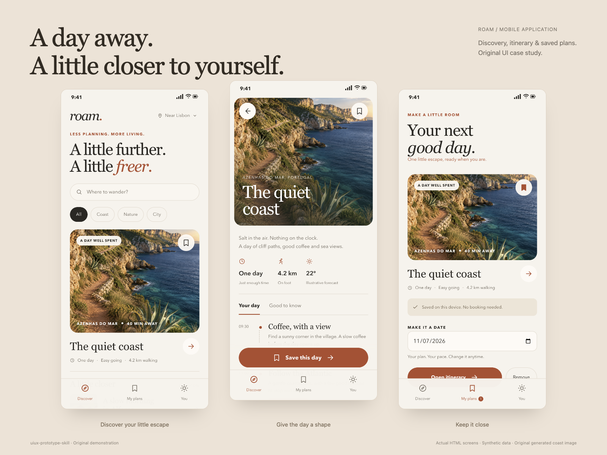
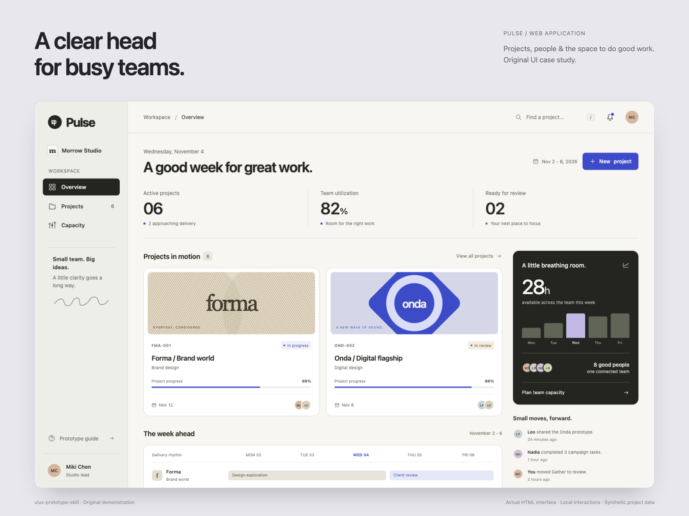
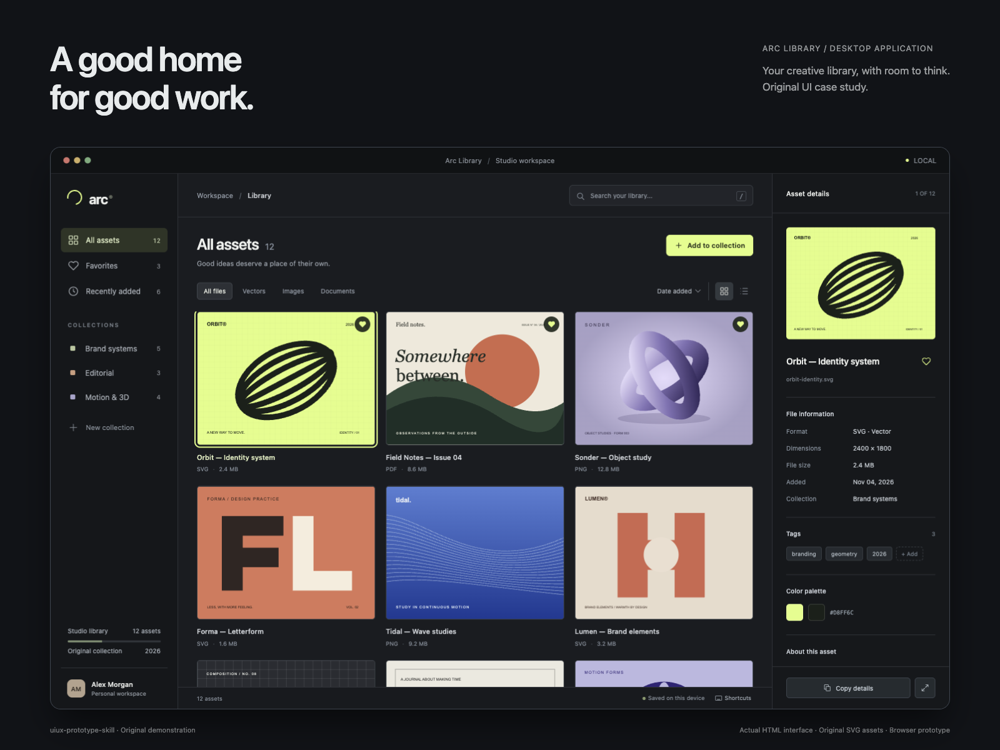
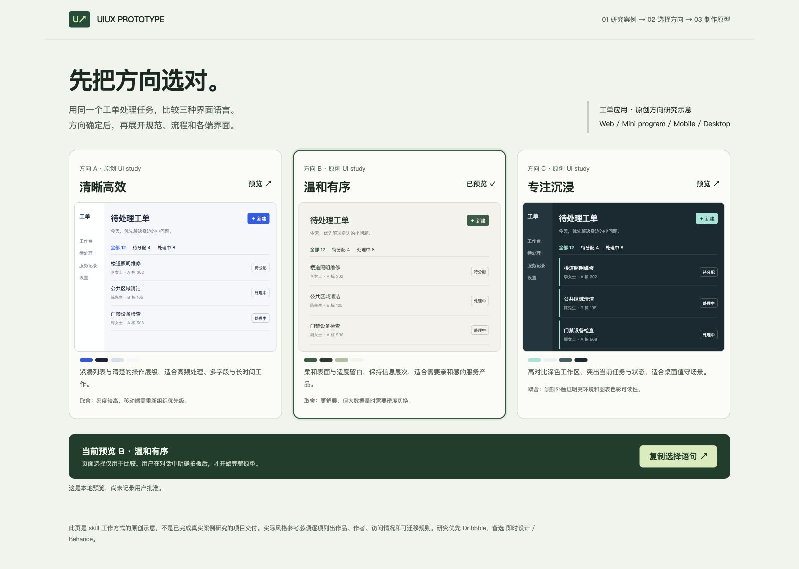

# UIUX Prototype Skill

[English](README.md) | **简体中文**

**先看案例，选定方向，再交付完整的产品 UI 原型。**

[](https://skills.sh/stella-dust/uiux-prototype-skill)
[](https://github.com/stella-dust/uiux-prototype-skill/releases)
[](LICENSE)



面向 **Web 应用、小程序、移动 App 和桌面 App** 的设计 skill。它围绕真实用户的任务组织界面，在开发应用前，先交付一套可浏览、可讨论、可版本管理的 HTML 原型。海报、PPT 和营销落地页不属于它的主要范围。

它整合了 [Emil Kowalski](https://github.com/emilkowalski/skills)、[Taste Skill](https://github.com/Leonxlnx/taste-skill)、[UI/UX Pro Max](https://github.com/nextlevelbuilder/ui-ux-pro-max-skill)、[Anthropic frontend-design](https://github.com/anthropics/skills/tree/main/skills/frontend-design)、[Impeccable](https://github.com/pbakaus/impeccable)、[Hallmark](https://github.com/nutlope/hallmark)、[UXKIN](https://github.com/uxkin/agent) 的适用原则，补充 [Stageshow](https://github.com/benjitaylor/skills/tree/main/stageshow)、[shadcn](https://github.com/shadcn-ui/ui/tree/main/skills/shadcn) 和 [Web Design Reviewer](https://github.com/github/awesome-copilot/tree/main/skills/web-design-reviewer)，共 **31 个来源 skills**。这是面向产品应用的原创整合，独立运行，不需要再安装上游 skills，也不绑定付费服务。[逐项映射与冲突处理](skills/uiux-prototype-skill/references/source-synthesis.md) · [来源与许可](THIRD_PARTY_NOTICES.md)

## 三个完整案例

使用这个 skill 制作的三个原创、可交互 HTML 原型。点击配图可查看完整分辨率。

| Roam · 移动端 | Pulse · Web 端 | Arc Library · 桌面应用 |
|---|---|---|
| [](docs/images/cases/01-roam-mobile.png) | [](docs/images/cases/02-pulse-web.png) | [](docs/images/cases/03-arc-desktop.png) |
| 轻旅行发现、行程详情与计划收藏 | 创意团队项目、产能与协作工作台 | 素材浏览、集合管理与元数据检查器 |
| [原型源码](examples/roam-mobile/docs/prototype/versions/v0.1.0/mobile/index.html) · [设计规范](examples/roam-mobile/docs/prototype/versions/v0.1.0/design-system.html) | [原型源码](examples/pulse-web/docs/prototype/versions/v0.1.0/web/index.html) · [设计规范](examples/pulse-web/docs/prototype/versions/v0.1.0/design-system.html) | [原型源码](examples/arc-desktop/docs/prototype/versions/v0.1.0/desktop/index.html) · [设计规范](examples/arc-desktop/docs/prototype/versions/v0.1.0/design-system.html) |

每个案例都保留风格参考 HTML、来源观察、共享与各端 DESIGN.md、可视化 UI 规范、浏览器 QA 和封版指纹。界面图形均为原创；海岸主视觉为原创生成的虚构场景。案例使用演示数据与本地交互。

[查看全部案例源码](examples/README.zh-CN.md)。克隆仓库后，在根目录运行 `python3 -m http.server 8765 --bind 127.0.0.1`，再打开 [localhost:8765/examples/](http://localhost:8765/examples/)。GitHub 中的 HTML 链接显示源码，本地服务用于运行界面。

## 工作方式

1. **理解产品。** 读取项目的 AGENTS.md、HANDOFF.md、DESIGN.md 和现有界面，明确用户、场景、入口、处理路径、结果、本轮页面与端的范围。
2. **研究并展示风格。** 优先 Dribbble，备选即时设计、Behance；记录实际看见的作品、作者、来源、访问情况和可迁移规则。通常给出 2–3 个有实质区别的方向，先交付 `style-reference.html`。
3. **等用户拍板。** 选择一个方向、要求融合或修改。页面里的预览按钮不会自动批准，也不会启动完整原型制作。
4. **生成完整 HTML 原型。** 交付原型首页、可视化 UI 设计规范、DESIGN.md，以及本轮所有目标端的应用界面和关键流程。
5. **浏览器检查并封版。** 检查实际交互、状态、长内容、响应式、键盘、减少动态效果等，记录验证范围与仍未解决的问题，保留旧版本。



[查看可交互的风格参考示例](docs/style-reference-example.html)。下载仓库后用浏览器打开，或按下文启动本地服务。图片和示例界面均为本仓库原创；它们解释工作方式，**不冒充一次真实案例研究或已获批准的项目设计**。

## 安装

需要能读取 Agent Skills 的工具。下面的市场 CLI 需要 Node.js 22.20+；原型版本助手仅需 Python 3.10+、无需第三方 Python 包。

**Codex，全局安装：**

```bash
npx skills@latest add stella-dust/uiux-prototype-skill \
  --skill uiux-prototype-skill -g -a codex -y
```

**其他支持的 agent / 自行选择安装范围：**

```bash
npx skills@latest add stella-dust/uiux-prototype-skill
```

**固定到本次正式版本：**

```bash
npx skills@latest add \
  https://github.com/stella-dust/uiux-prototype-skill/tree/v1.0.0/skills/uiux-prototype-skill \
  -g -a codex -y
```

CLI 的 Codex 全局目录现为 `~/.agents/skills/`。部分 Codex 环境使用 `~/.codex/skills/`；手动安装时，把仓库中的 `skills/uiux-prototype-skill/` 整个目录复制到环境实际读取的目录即可。先检查同名 skill，避免两个目录重复安装；更新前保存旧副本，别直接覆盖定制内容。

[CLI 官方安装参数](https://github.com/vercel-labs/skills/blob/main/docs/commands.md) · [各 agent 路径](https://github.com/vercel-labs/skills/blob/main/docs/agents.md)

## 开始使用

在项目中调用：

```text
使用 $uiux-prototype-skill 为我们的住户服务产品设计原型。
目标端是微信小程序和 Web 管理端。
先读现有产品文档和 DESIGN.md，保留品牌蓝色。
先做案例研究和风格参考 HTML，等我选定方向再开发完整原型。
```

已有产品也可以这样描述：

```text
使用 $uiux-prototype-skill 打磨现有工单界面。
保留信息架构和品牌，改善密度、状态、错误恢复与跨端适配。
先展示风格方向和变化依据，不要从零重设计。
```

批准后的下一轮：

```text
选择方向 B，保留它的布局、字体与密度，按当前风格参考开发完整原型。
```

默认允许 agent 自动发现这个 skill；也可显式调用。它会根据项目和需求确定本轮要覆盖的端，而不是为任何产品强造四套应用。若你需要四端，在需求里写清楚。

## 交付目录

```text
project/docs/prototype/
├── index.html                         # 保留版本的导航
├── CHANGELOG.md
└── versions/v0.1.0/
    ├── manifest.json                  # 方向、批准记录、状态和封版指纹
    ├── style-reference.html           # 先交付，等你选择
    ├── references.json                # 研究来源与观察范围
    ├── index.html                     # 原型导航首页
    ├── design-system.html             # 可视化规范和实际组件状态
    ├── DESIGN.md                      # 设计契约与精确 token
    ├── QA.md                          # 实际检查与边界
    ├── assets/
    ├── web/{index.html,DESIGN.md}
    ├── miniapp/{index.html,DESIGN.md}
    ├── mobile/{index.html,DESIGN.md}
    └── desktop/{index.html,DESIGN.md}
```

只生成本轮要求的端。每端可以多页，也可以在 HTML 内实现路由和状态；首页包含应用入口，不是只有一张静态封面。规范覆盖本轮用到的颜色、字阶、间距、密度、布局、图标、组件、状态、动效、无障碍和平台差异。

## 原型版本助手

工具管理流程和文件，不会自动设计界面。以下在仓库根目录运行；安装后把脚本路径换成安装目录的绝对路径。`--project` 是实际应用项目根目录。

```bash
python3 skills/uiux-prototype-skill/scripts/prototype.py init \
  --project /path/to/project --version v0.1.0 --surfaces web miniapp
```

此时只有风格参考草稿和 manifest。agent 必须先完成研究、替换草稿并等用户选择。之后记录**用户真实原话**：

```bash
python3 skills/uiux-prototype-skill/scripts/prototype.py record-approval \
  --project /path/to/project --version v0.1.0 \
  --direction B --evidence "用户明确批准该版本方向 B 的真实原话"

python3 skills/uiux-prototype-skill/scripts/prototype.py prepare \
  --project /path/to/project --version v0.1.0
```

`prepare` 生成待设计脚手架，不能当作完成的原型。替换草稿，走通约定流程并做浏览器检查后：

```bash
python3 skills/uiux-prototype-skill/scripts/prototype.py validate \
  --project /path/to/project --version v0.1.0 --complete

python3 skills/uiux-prototype-skill/scripts/prototype.py seal \
  --project /path/to/project --version v0.1.0 \
  --summary "填写实际浏览器、视口、操作结果和未验证项"
```

工具会检查批准对应的风格 HTML 指纹、必需文件、草稿标记、本地 HTML 链接、研究 JSON 语法、符号链接/路径越界，以及封版后的文件变化。修改风格参考会使批准失效；旧版本不覆盖。`record-approval` 只保存调用方给出的记录，不验证身份；`seal` 是可检测变化的约定，不是操作系统锁定，也不是视觉验收。

本地浏览（示例）：

```bash
python3 -m http.server 8765 --bind 127.0.0.1 --directory /path/to/project/docs/prototype
```

再打开 `http://127.0.0.1:8765/versions/v0.1.0/`。仓库中的风格示意也可以通过同样方式以 `--directory docs` 预览。

## 整合的取舍

| 来源 | 留下的关键能力 |
|---|---|
| [Emil Kowalski](https://github.com/emilkowalski/skills)，16 个 skills | 是否需要动效、频率/曲线/时长/源点、中断、性能、边界内容、原生感、成熟组件选择 |
| [Taste Skill](https://github.com/Leonxlnx/taste-skill) | 从需求推断方向、尊重品牌、真实素材与浏览器自查 |
| [UI/UX Pro Max](https://github.com/nextlevelbuilder/ui-ux-pro-max-skill) | 产品类型、语义 token、字体/色彩/布局、跨端规范和 UX 反模式 |
| [Anthropic frontend-design](https://github.com/anthropics/skills/tree/main/skills/frontend-design) | 有目的的视觉选择和统一的实现，不接受模板默认值 |
| [Impeccable](https://github.com/pbakaus/impeccable) | 分层审计、去冗余、可访问性、状态、响应式和有证据的修正 |
| [Hallmark](https://github.com/nutlope/hallmark) | 案例/素材真实性、主任务优先、保留原有功能、分级质量门槛 |
| [UXKIN](https://github.com/uxkin/agent)，7 个 skills | 真实产品研究、状态覆盖、设计契约、截图对比和各端工作流 |
| [Stageshow](https://github.com/benjitaylor/skills/tree/main/stageshow) / [shadcn](https://github.com/shadcn-ui/ui/tree/main/skills/shadcn) / [Web Design Reviewer](https://github.com/github/awesome-copilot/tree/main/skills/web-design-reviewer) | 可审阅产品场景、复用已有组件、实际浏览器反馈 |

舍弃与应用 UI 不相容的营销页分区定额、颜色/字体一刀切禁令、随机选主题和无条件装依赖。正式品牌、真实任务和平台约束优先；动效服务操作，不能阻碍高频任务。所有来源的具体映射和版本证据见 [source-synthesis.md](skills/uiux-prototype-skill/references/source-synthesis.md)。

## 验证与边界

```bash
python3 -m unittest discover -s tests -v
```

测试覆盖批准门禁、批准指纹失效、旧版保护、跨端文件、本地链接、越界/符号链接、QA/研究记录、未完成脚手架和封版变更检测。流程检查不能替代风格判断；HTML、浏览器模拟和本地状态不证明小程序宿主、原生 SDK、支付、发送、后台写入、正式上线或业务效果。

Dribbble、即时设计和 Behance 可能有登录或访问限制；skill 会记录实际结果并使用可用备选。第三方截图的可浏览性不代表再分发许可。UXKIN 的账号/套餐是可选的参考增强，不是基础依赖。

## 发布和市场收录

源代码和正式版本发布在 [GitHub](https://github.com/stella-dust/uiux-prototype-skill)。按 [skills.sh 官方 FAQ](https://skills.sh/docs/faq)，目录通过正常安装遥测自动收录，没有独立的人工发包步骤；公开仓库不等于榜单立即可见，收录时间由平台决定。本项目不通过重复安装制造计数。

见 [CHANGELOG.md](CHANGELOG.md) 和 [发布记录](https://github.com/stella-dust/uiux-prototype-skill/releases)。欢迎提交具体场景、复现步骤、原型范围和浏览器证据，改进 skill，而不是把一次偏好写成全局规则。

## 许可

本仓库原创指令、版本助手与演示采用 [MIT](LICENSE)。上游项目保留各自许可证，未复制其脚本、组件、主题库或作品图。[THIRD_PARTY_NOTICES.md](THIRD_PARTY_NOTICES.md)
